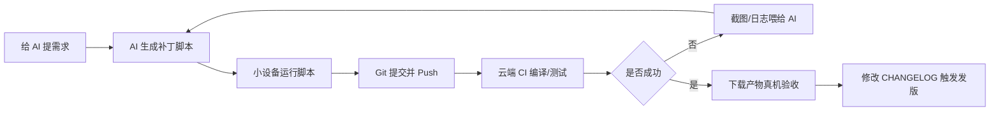

# 手机 / 小设备 + AI 开发软件通用实战指南

> 一套不绑定具体项目、具体语言、具体平台的开发方法论。  
> 适用于任意软件项目：App、服务端、CLI、Web、桌面端、嵌入式、跨端工具等。

- **手机 / 平板 / 小设备**：指挥台、代码注入器、Git 客户端、验收终端
- **AI**：代码工人、补丁生成器、报错修复器
- **云端 CI**：编译机、测试机、打包机、发版机
- **你**：架构师、规范制定者、QA、流水线调度员

> 核心原则：**小设备不承担重型编译，只做控制、改文件、提交和验收。**

---

## 目录

- [1. 核心认知](#1-核心认知)
- [2. 通用工具链](#2-通用工具链)
- [3. 人机分工](#3-人机分工)
- [4. 通用开发闭环](#4-通用开发闭环)
- [5. 通用架构设计原则](#5-通用架构设计原则)
- [6. 通用 CI/CD 与自动发版](#6-通用-cicd-与自动发版)
- [7. 通用避坑清单](#7-通用避坑清单)
- [8. 最小行动清单](#8-最小行动清单)
- [9. 通用开发军规](#9-通用开发军规)
- [10. 如何适配你的项目](#10-如何适配你的项目)

---

## 1. 核心认知

一句话总结：

> **小设备是“指挥台”，AI 是“代码工人”，云端 CI 是“编译机”。**

你负责：

- 定需求
- 定架构
- 定规范
- 验收和排雷
- 调度 CI/CD

AI 负责：

- 写代码
- 写 UI
- 写协议
- 写 CI 配置
- 根据报错生成修复补丁

云端负责：

- 多端并行编译
- 自动测试
- 自动打包
- 自动发版

**不要把手机当 IDE，要把手机当指挥终端。**

---

## 2. 通用工具链

| 工具 | 通用作用 |
|---|---|
| AI 大模型 | 需求拆解、代码生成、补丁脚本、CI 报错分析 |
| 手机 / 小设备 | 指挥、验收、轻量编辑、Git 操作 |
| Termux / Pydroid 3 等 | 运行 Python / Shell 补丁脚本，批量覆盖项目文件 |
| MGit 等移动端 Git 工具 | Stage、Commit、Push、Pull |
| GitHub Actions / 任意云端 CI | 并行编译、测试、打包、发版 |
| 真机 / 旧设备 / 测试机 | 安装测试、抓日志、截图验收 |

### 推荐工作方式

不要让 AI 分块给代码。要求 AI 每次输出：

- 一个**全量覆盖的补丁脚本**
- 脚本中包含明确文件路径
- 脚本尽量**幂等**，可重复执行
- 脚本执行后可直接提交

示例：

```bash
python patch_20261022_fix_ci.py
```

然后：

```bash
git add .
git commit -m "fix: apply AI patch"
git push
```

> 工具可以换，核心不变：**AI 产出脚本，小设备执行脚本，Git 提交，云端编译。**

---

## 3. 人机分工

### 你负责的四件事

1. **需求定义与架构决策**
   - 项目拆端：服务端、客户端、Web、CLI、桌面端、嵌入式端等
   - 技术选型：语言、框架、协议、存储、部署方式
   - 跨网 / 跨端方案：直连、中转、穿透、同步机制等
   - 兼容性基线：最低系统版本、最低依赖版本、目标设备范围

2. **规范制定**
   - 包名 / 命名空间 / 目录结构
   - API 契约：路由、参数、返回结构
   - 版本规则
   - 多语言规范
   - 日志规范
   - 安全规范

3. **环境排雷与 QA**
   - 真机安装
   - 抓日志
   - 截图报错
   - 验证启动、核心功能、异常恢复、性能底线

4. **流水线调度**
   - 把 CI 错误日志喂给 AI
   - 让 AI 输出修复补丁
   - 推动闭环直到绿勾

### AI 负责的 99% 编码

- 底层协议
- 业务逻辑
- UI 界面
- 多语言字典
- CI 配置
- 修复补丁脚本
- README、API 文档、安全策略

> AI 是顶级打工人，你是顶级包工头。  
> 不要指望 AI 一次性写出完美架构，你要提供准确上下文：错误日志、报错行号、崩溃截图、相关文件。

---

## 4. 通用开发闭环



完整循环：

1. **需求拆解（人）**：明确要加什么功能、改什么行为、验收标准是什么。
2. **代码实现（AI）**：让 AI 输出全量补丁脚本，而不是零散代码块。
3. **小设备注入**：手机 / 平板 / 小设备运行脚本，批量替换文件。
4. **Git 提交**：Stage、Commit、Push。
5. **云端编译**：CI 自动编译 / 测试。
6. **失败回喂**：截图或日志喂给 AI，AI 输出修复脚本。
7. **循环直到绿勾**。
8. **真机验收**：下载产物，安装、运行、抓日志、验证。
9. **CHANGELOG 驱动发版**：修改版本号，触发自动发版。

> **提需求 → AI 出补丁 → 设备注入 → Git Push → 云端编译 → 报错回喂 → 循环 → 验收 → 发版。**

---

## 5. 通用架构设计原则

### 5.1 彻底解耦

不要做单体应用。至少拆成：

- **Core**：核心逻辑
- **Server / Service**：服务与协议
- **Client / UI**：界面壳
- **Infra**：构建、配置、脚本、CI

原则：

- 服务端只对外暴露稳定 API。
- 客户端只负责请求和渲染。
- 稳定 **API 契约**：路由、参数、数据结构不变。
- 内部实现可以让 AI 全量重写。
- 模块之间物理隔离，方便独立替换和独立编译。

### 5.2 资源受限端拥抱轻量方案

在手机、电视、手表、嵌入式设备等资源受限端：

- 避免重型框架和不必要的依赖。
- 优先原生能力、轻量服务、低内存方案。
- 追求低包体、快启动、低功耗。
- 兼容性基线一旦确定，就不要轻易突破。

### 5.3 跨网 / 跨端能力分层演进

通用思路：

| 阶段 | 方案 | 目标 |
|---|---|---|
| 第一代 | 中转服务 | 先能用，零配置 |
| 第二代 | 直连 / 公网直连 | 提升速度，降低中转依赖 |
| 第三代 | 穿透 / 打洞 | 提升通用性和连通率 |

经验：

- 先做能用的，再做快的，最后做通用的。
- 协议选型由你拍板，底层脏活交给 AI。
- 每一代都要保留降级路径。

### 5.4 一开始就做国际化和配置持久化

- 国际化管理器从第一天就接入。
- 新增 UI 必须走国际化接口，避免后期补字典。
- 配置模型统一序列化，支持导入 / 导出 / 迁移。
- 配置变更要可追踪、可回滚。

### 5.5 安全底线

- 文件操作必须校验规范化路径，防止路径穿越。
- 所有对外 API 做参数校验。
- 敏感操作要有权限控制。
- 日志中避免泄露密钥和隐私。
- 文档中写清安全策略。

### 5.6 生命周期与保活（按平台适配）

移动端 / 嵌入式端要考虑：

- 前台服务
- 唤醒锁
- 后台保活
- 异常重启
- 开机自启
- 资源回收

> 不绑定具体平台，但必须按目标平台设计生命周期。

---

## 6. 通用 CI/CD 与自动发版

### 6.1 日常编译

- 日常提交只触发受影响端的编译。
- 节省 CI 时间。
- 产物放 Artifacts，用于测试。

### 6.2 CHANGELOG 驱动发版

通用机制：

1. CI 默认监听主分支。
2. 每次 Push 自动跑测试和编译。
3. 修改 `CHANGELOG.md` 中的版本号。
4. CI 检测版本号变化。
5. 自动打 Tag。
6. 自动提取 CHANGELOG 描述。
7. 自动把各端产物挂到 Release。

示例：

```markdown
## [x.y.z] - YYYY-MM-DD
```

### 6.3 Release 权限

自动发 Release 必须显式声明写权限。以 GitHub Actions 为例：

```yaml
permissions:
  contents: write
```

否则可能报错：

```text
Resource not accessible by integration
```

### 6.4 发版容错

发版脚本加容错，避免一个端失败阻断全部发布：

```bash
build_command || true
```

原则：

> 一个端崩了，不应该阻断其他端的发布。

### 6.5 版本号统一注入

- 绝不手改多端版本号。
- 用脚本从 `CHANGELOG.md` 读取版本号。
- 云端自动注入到各端项目文件。

### 6.6 产物平铺直传

不要只打一个大压缩包。让 CI 自动提取各端产物并重命名：

```text
Project-Server-vX.Y.Z.zip
Project-Client-vX.Y.Z.apk
Project-Web-vX.Y.Z.zip
Project-CLI-vX.Y.Z.zip
Project-Desktop-vX.Y.Z.zip
```

直接并排铺在 Release 页面。

---

## 7. 通用避坑清单

### 坑点 1：Git 强制推送覆盖远程代码

**现象：**

本地旧代码强推，覆盖远程新功能。

**恢复流程：**

1. 在托管平台找到被覆盖前最后一次有效 Commit。
2. 用该提交新建备份分支。
3. 创建 PR 并合并回主分支。
4. 本地放弃更改，先 Pull 最新状态。

**铁律：**

> 开工前先 Pull，改完先 Commit，强推之前看一眼。

---

### 坑点 2：构建参数向下穿透

**现象：**

编译某个端时，底层依赖报错找不到另一平台的包。

**原因：**

架构参数、目标框架参数可能向下穿透给所有依赖项目。

**解法：**

发布时强制隔离目标框架 / 目标平台参数，只对当前端生效。

---

### 坑点 3：命名包含保留字

**现象：**

包名、命名空间、模块名导致编译器或构建工具崩溃。

**原因：**

包含目标语言或平台的保留关键字。

**教训：**

命名前检查所有目标语言的保留字。使用安全替代词。

---

### 坑点 4：系统 API 版本断层

**现象：**

旧代码在新 SDK 中大量报错。

**原因：**

API 改名、构造函数废弃、参数移除。

**教训：**

不要盲目相信 AI 记忆。以当前 SDK 编译报错为准，让 AI 实时修正。

---

### 坑点 5：CI 发版权限不足

**现象：**

```text
Resource not accessible by integration
```

**原因：**

CI Token 默认只读。

**解法：**

显式声明写权限，并允许覆盖旧 Release。

---

### 坑点 6：路径穿越漏洞

AI 极易写出：

```text
../../etc/passwd
```

**解法：**

文件操作 API 必须反复校验规范化路径。

---

### 坑点 7：多端版本号错乱

**解法：**

- 绝不手改版本号。
- 全部由脚本从 `CHANGELOG.md` 自动读取并注入。

---

### 坑点 8：后期补多语言

**解法：**

- 项目第一天就配置国际化。
- 新增 UI 必须走国际化接口。

---

### 坑点 9：补丁脚本不幂等

**现象：**

重复执行脚本导致重复插入、文件损坏。

**解法：**

让 AI 生成幂等脚本：先检查再修改，可重复执行。

---

## 8. 最小行动清单

- [ ] 建代码仓库
- [ ] 配置云端 CI
- [ ] 小设备安装终端工具
- [ ] 小设备安装移动端 Git 工具
- [ ] 让 AI 生成项目骨架
- [ ] 让 AI 生成补丁脚本
- [ ] 小设备运行脚本
- [ ] Git 提交并 Push
- [ ] CI 编译
- [ ] 失败日志截图喂 AI
- [ ] 循环到绿勾
- [ ] 下载产物真机验收
- [ ] 用 `CHANGELOG.md` 驱动自动发版
- [ ] 补齐 README、API 规范、安全策略

---

## 9. 通用开发军规

1. **AI 是顶级打工人，你是顶级包工头。** 提供准确上下文，把活切碎了喂。
2. **脚本化思维。** 修 Bug 尽量让 AI 提供幂等补丁脚本。
3. **保护好工作流。** 小设备开发必须配 Git 工具，随时同步。
4. **开工前先 Pull，改完先 Commit，强推之前看一眼。**
5. **隔离环境与生命周期。** 不要在一个老旧项目上无限叠加功能。
6. **多语言和国际化要趁早。**
7. **别当打字员，当架构师。**
8. **别迷恋增量修改，敢用全量重构。**
9. **别让小设备编译，让云端跑。**
10. **别手写代码，让 AI 写、你验收。**
11. **别信 AI 记忆，以编译报错为准。**
12. **别做单体应用，核心 / 服务 / 界面物理隔离。**
13. **别手改版本号，让 CHANGELOG 和 CI 自动注入。**
14. **别只打大压缩包，各端产物平铺 Release。**
15. **别忘安全底线，文件操作校验规范化路径。**
16. **文档即产品，README 也要让 AI 帮你写到极致。**

---

## 10. 如何适配你的项目

这套方法不绑定任何具体项目。替换以下变量即可：

| 通用概念 | 你的项目替换为 |
|---|---|
| 小设备 | 手机、平板、手表、旧电脑、树莓派等 |
| 终端工具 | Termux、Pydroid、iSH、SSH 客户端等 |
| Git 工具 | MGit、Working Copy、命令行 Git 等 |
| 云端 CI | GitHub Actions、GitLab CI、Gitea Actions 等 |
| 补丁脚本 | Python、Shell、PowerShell、Node.js 等 |
| 端 | 服务端、客户端、Web、CLI、桌面端、嵌入式端 |
| 版本源 | `CHANGELOG.md` 或任意版本文件 |
| 产物 | APK、ZIP、EXE、Docker 镜像、二进制等 |

**核心不变：**

> 人定需求和架构，AI 写代码和补丁，小设备执行和提交，云端编译和发版，真机验收和回喂。

---

## 结语

从一部手机、一块手表开始，到云端 CI 绿勾，再到 Release 页面整整齐齐的产物。

旧时代需要你背诵语法、熬夜查堆栈；新时代需要你具备：

- 清晰的产品逻辑
- 严密的架构意识
- 扎实的安全底线
- 对版本控制的深刻理解
- 永不妥协的极客精神

> **提需求，让 AI 去写，让云端去跑，让世界去惊叹。**

下一场战斗，已经在路上了。

---

## License

本文档可自由用于个人博客、GitHub Wiki、团队内部手册。转载请注明来源。
